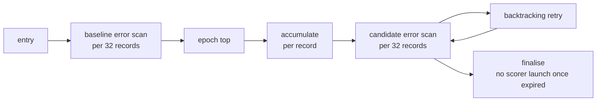

## Summary

`run_train_until(req, Option<&Deadline>)` makes the native trainer stop cooperatively at an absolute
deadline *inside* an epoch and return the learning completed before the stop. `run_train(req)` is
now `run_train_until(req, None)`, so no-deadline calls keep today's acceptance and validation.
Version bump: `backpropagation/Cargo.toml` is left to the repository's version-increment workflow.
Closes #213.

## Spec

### Intent and Rationale

- A deadline checked only before each epoch cannot bound a long first epoch, so the check lives in the
  baseline scan, per accumulated record, the candidate scan, each backtracking retry and every scorer
  launch. The earlier candidate branch (`issue-neat-ai-4073-train-deadline`, a single epoch-top check
  plus FFI/CLI plumbing) was reviewed; its absolute-millisecond deadline and `timedOut` journal line
  are reused, its epoch-boundary-only check is not.
- Expiry mid-accumulation (or before/during the candidate scan) applies the partial learning once and
  keeps it only if it beats the incumbent on the *same* first N records (N = min(records read, 256)).
  Both figures are real measurements over identical records, so a partial figure is never compared
  with a full-corpus one.

### Essential Design Decisions

- `TrainResult.baseline_mse`/`best_mse` (f64) become `baseline`/`best: ErrorMeasure`
  (`Full`/`Partial`/`Unmeasured`) so a partial or missing measurement is never passed off as a
  full-corpus error. The C ABI keeps its f64 fields and fails loudly if a figure is not `Full`
  (it never passes a deadline). Assumption: replacing the fields is preferable to keeping NaN-able
  f64s; the CLI prints `n/a` for an absent full figure.
- The post-deadline verification scan is bounded by `PARTIAL_VERIFY_RECORDS = 256` records per
  creature (2 x 256 forward passes). Under `accept_always` a verified-worse partial candidate is
  still kept, as in a normal epoch. Scorer-guided and ladder modes cannot verify a partial
  candidate, so they keep the incumbent.
- A timed-out run launches no scorer scan in finalisation (`best_score` falls back to the known
  incumbent score), and a deadline-bound scan checks the clock every 32 records, so numerics can
  differ from the unbounded streaming route in the last float bits.

### Undiscoverable Facts

- Native elapsed-time enforcement and the FFI/CLI exposure of the deadline belong to the dependent
  adapter work; this change touches no wire format. `journal.jsonl` gains a `timedOut` final line
  (timed-out runs only) and a `partial` epoch field (default false).

## Evidence

Backend-only change; no UI files. Evidence is the test run below and the mutation checks in the Test
Plan. `./quality.sh` passed on the final head (exit 0, "All quality checks passed!").

## Reproduction

- **symptom** — a long first epoch could not be interrupted: the trainer only ever finished the whole
  baseline scan, accumulation and candidate scan, so a task deadline either cost the whole epoch's
  learning or hit the watchdog.
- **status** — `partial` — reason: the pre-fix behaviour (no deadline entry point) cannot be driven by
  the new tests, which need the new API; the base-branch code has no deadline argument, so the tests
  fail to compile there. Each check was instead removed individually (see the Test Plan) and its test
  went red.
- **regression test** — `backpropagation/tests/train_deadline.rs::expiry_during_accumulation_in_the_first_epoch_keeps_useful_partial_learning`

## Acceptance Criteria

<!-- vibe-spec-review inputs="diff+issue-body" -->

- **met** — Separate tests reach expiry during initial evaluation, accumulation and candidate evaluation; each fails when only its interruption check is removed — evidence: `backpropagation/tests/train_deadline.rs::expiry_during_the_initial_evaluation`, `::accumulation_expiring_before_any_record_journals_nothing`, `::expiry_during_candidate_evaluation` — reviewer: met
- **met** — A productive first-epoch fixture stops before completing that epoch and returns valid weights different from its input. An interruption in a later epoch retains earlier accepted learning — evidence: `backpropagation/tests/train_deadline.rs::expiry_during_accumulation_in_the_first_epoch_keeps_useful_partial_learning`, `::a_later_epoch_interruption_retains_earlier_accepted_learning` — reviewer: met
- **met** — Expiry before useful work returns unchanged weights with explicit timeout and no-progress/measurement status, without fabricated improvement or error values — evidence: `backpropagation/tests/train_deadline.rs::an_already_expired_deadline_returns_the_input_unchanged_with_no_measurement`, `::expiry_on_the_very_first_tick_measures_nothing` — reviewer: met
- **met** — Deadline handling also bounds retries/backtracking and finalisation. Tests exercise these paths; no post-timeout whole-corpus rescore is required to return — evidence: `backpropagation/tests/train_deadline.rs::expiry_between_backtracking_attempts_stops_the_retry_loop`, `::finalisation_launches_no_scorer_after_expiry`, `::finalisation_does_not_launch_the_best_scorer_after_expiry` — reviewer: partial — reason: the reviewer found the ladder's rung scans uninterruptible; fixed in this diff (ladder rungs use `compute_mse_until`; `::a_ladder_rung_is_interrupted_inside_its_scan`)
- **met** — No-deadline calls retain existing training acceptance and validation behaviour; relevant tests and the repository quality gate pass — evidence: whole `cargo test` plus `./quality.sh` exit 0 on the final head; `::a_distant_deadline_matches_the_unbounded_run` — reviewer: partial — reason: reviewer could not run the gate; it was run here and passed

## Standards Review

<!-- vibe-standards-review inputs="diff+CODING-STANDARDS.md" -->

- **violation** — README/CHANGELOG said a partial epoch is kept only if it lowers the error, false under `accept_always` — evidence: `README.md:946` — reason: fixed in this diff
- **violation** — Test stubs more permissive than the real scorer with no contract source named — evidence: `backpropagation/tests/train_deadline.rs:247` — reason: fixed in this diff (stubs validate their arguments and name `src/scorer.rs` and `tests/scorer_boundary.rs`)
- **clean** — Australian English, fail-loud handling of missing measurements, no unused public members (`TrainResult::timed_out` removed), edited existing tests only swap field accessors and still guard the same behaviour. No `CODING-STANDARDS.md` exists in this repository, so the reviewer applied the shared guidelines.

## Test Plan

- Added `backpropagation/tests/train_deadline.rs` (19 tests, deterministic via an injected counting
  clock; each phase test scans expiry ticks and panics if no tick reaches its phase, so removing
  only its check turns it red) and unit tests in `src/deadline.rs` (including `the_deadline_reports_the_instant_it_was_built_with`, which pins `Deadline::epoch_ms`), `src/mse.rs` and
  `src/propagate_layout.rs`.
- Mutation checks (one check disabled at a time, test went red, check restored): baseline-scan
  deadline, accumulation deadline, candidate-scan deadline, backtracking check, finalisation scorer
  checks (baseline and best), epoch-top check, ladder in-scan, between-rung and before-batch checks,
  baseline and per-candidate scorer-launch checks, partial-epoch retention, and the `Unmeasured`
  partial fallback.
- Existing tests edited only to read `result.baseline.full_mse()` / `result.best.full_mse()` in
  place of `baseline_mse` / `best_mse` (`src/train.rs` tests, `tests/record_sampling.rs`,
  `tests/scorer_guided_acceptance.rs`, `tests/step_scale_ladder.rs`,
  `tests/trained_creature_validation.rs`); no assertion was removed or weakened.
- Mutation survivors from the gate: `deadline.rs:60` (`epoch_ms` -> 0/1) is killed by
  `the_deadline_reports_the_instant_it_was_built_with`; `train.rs:535` (`<` -> `>` / `<=` in
  `partial_outcome`) is killed by `train_deadline.rs::a_partial_epoch_that_only_ties_the_incumbent_is_rejected`
  (a perfect-fit corpus makes the partial candidate tie the incumbent, so only `<` rejects it). Re-run with
  `cargo mutants` filtered to `partial_outcome` and `epoch_ms`: all viable mutants caught.
  `backpropagation/src/train.rs:557` exempt (untestable): `Ok(Default::default())` for `run_train` does not
  compile because `TrainResult` has no `Default`, so cargo-mutants reports it unviable; `run_train` is
  also exercised by the existing `src/train.rs` and `tests/` callers.
- `./quality.sh` on the final head: passed.
- Callers of the changed `TrainResult` checked: `src/ffi.rs`, `src/main.rs`; `run_ladder_epoch`'s only
  caller is `src/train.rs`. Related docs updated: README "Train deadline and partial results",
  CHANGELOG.

Not done / remaining risk: the C ABI and CLI do not expose the deadline yet (out of scope); a single
scorer process or 32-record batch is not preempted; the partial verification is in-sample on at most
256 records.
