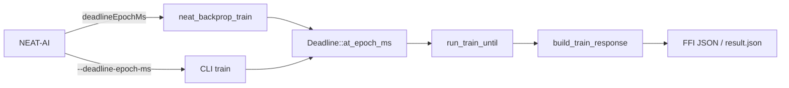

## Summary

Exposes the #213 cooperative deadline through both native entry points. The C ABI request takes `deadlineEpochMs`; the CLI `train` takes `--deadline-epoch-ms`. Both use the core's unit (whole milliseconds since the Unix epoch) and expiry rule (`clock >= deadline`), and both call `run_train_until` with `Deadline::at_epoch_ms`, so the absolute budget is never restarted. Responses carry `timedOut`, a `timeout` object, `completedEpochs` and explicit `baselineMeasure` / `bestMeasure`. `baselineMse` / `bestMse` are numbers only for a full measure and `null` otherwise. `neat_backprop_capabilities()` and the CLI `capabilities` subcommand let NEAT-AI probe for deadline support. The CLI also writes `result.json` (the same object as the FFI response). Version bump: `Cargo.toml` updated for this change; the merged commit records the final version. Closes #214.

## Spec

### Intent and Rationale

- NEAT-AI needs bounded return from native training; #213 built the core, this PR only adds adapters, contract and integration tests.
- One shared `build_train_response` builds the response for both entry points, so they cannot drift.

### Essential Design Decisions

- ABI version stays `1`: every change is additive for a caller that sends no deadline. The probe is the new `neat_backprop_capabilities` symbol (absent in old libraries) with `deadline.version = 1`.
- Assumption: a negative, fractional, string or boolean `deadlineEpochMs` is refused with `NEAT_BACKPROP_ERR_INVALID_ARGUMENT` naming the field; `null` equals omitted; `0`/`1` are valid already-expired deadlines.
- Assumption: the CLI reports machine-readable output as `<output-dir>/result.json`; stdout stays empty for `train`.
- The removed `FFI_FULL_MEASURE` refusal is replaced by nullable MSE fields plus measure kinds, so an incomplete figure is never labelled a full-corpus score.

### Undiscoverable Facts

- Accumulation costs about 20–28× a baseline scan on this crate (debug build), and the baseline must finish inside a ~1 s deadline. Shapes tried (wide, deep, narrow chain, many outputs, aggregate output, isolated neurons) all stayed in that range, so one uninterrupted epoch cannot alone exceed the 30 s grace (measured 4.4 s). The fixture requests 100 epochs (measured about 440 s of uninterrupted work, asserted by `the_productive_fixture_outlasts_the_deadline_and_the_grace_window`) and proves the cut was inside epoch 1 from the journal: one `partial: true` epoch line covering fewer than all records, `completedEpochs: 0`, final `timedOut` line. A check only between epochs cannot produce that.
- Measured: all three productive native tests (C ABI in process, C ABI via the built cdylib, CLI) return in about 1.05 s with a 1 s deadline.
- `cargo test` links the rlib but does not refresh the cdylib, so the cdylib test runs `cargo build --lib` first (before the deadline is computed) and the child asserts its `train` symbol is not the rlib copy.

## Evidence

Backend/CLI change; no UI. Evidence is `backpropagation/tests/native_deadline.rs` (16 tests): productive fixture (500 hidden neurons, 8000 records) through the real `neat_backprop_train` C ABI symbol, through the built cdylib loaded with `dlopen` in a child process (killed on overrun), and through the real CLI binary (`CARGO_BIN_EXE_neat_ai_backpropagation`, child process killed on overrun), a measurement test for the fixture's sizing, plus contract tests for omitted, null, far-future, expired (`0`, `1`), invalid values, legacy shape and the capability probe.

Forwarding reverts (deadline replaced by `None` in only that entry point): FFI productive test failed after 35 s (outer bound); CLI productive test failed after 35 s; cdylib productive test failed after 35 s (child killed). The FFI and cdylib tests share `src/ffi.rs` forwarding, so that one revert turns both red. Forcing `timed_out: false` in `build_train_response` turned 4 of the 13 tests then present red.

## Reproduction

- **symptom** — native FFI/CLI training ignored any caller deadline and ran the whole corpus, so the caller's watchdog fired instead of receiving learned weights
- **status** — `verified` — with the deadline forwarding reverted the productive tests fail (35 s overrun) and pass with it
- **regression test** — `backpropagation/tests/native_deadline.rs::ffi_deadline_stops_a_productive_first_epoch_mid_epoch`, `backpropagation/tests/native_deadline.rs::cli_deadline_stops_a_productive_first_epoch_mid_epoch`

## Acceptance Criteria

<!-- vibe-spec-review inputs="diff+issue-body" -->

- **met** — Each entry point forwards the supplied deadline to the same core; reverting only that forwarding makes its own test fail. — evidence: `backpropagation/src/ffi.rs`, `backpropagation/src/main.rs`; reverts failed the two productive tests — reviewer: met
- **met** — Each actual native path uses a short deadline (about 1 second) and an epoch that outlasts it, returns `timedOut: true` and valid weights different from input, and settles before the supplied deadline plus 30 seconds. — evidence: `backpropagation/tests/native_deadline.rs::ffi_deadline_stops_a_productive_first_epoch_mid_epoch`, `backpropagation/tests/native_deadline.rs::cdylib_deadline_stops_a_productive_first_epoch_mid_epoch`, `backpropagation/tests/native_deadline.rs::cli_deadline_stops_a_productive_first_epoch_mid_epoch`, `backpropagation/tests/native_deadline.rs::the_productive_fixture_outlasts_the_deadline_and_the_grace_window` — reviewer: met
- **met** — The fixture exercises a productive, unfinished first epoch, including work sized to exceed the entire grace window without interruption. Record evidence that it reaches that path; a check only between epochs cannot pass. — evidence: journal assertions in `assert_productive_response` (one `partial: true` epoch line, fewer than all records, `completedEpochs: 0`, closing `timedOut` line) and `backpropagation/tests/native_deadline.rs::the_productive_fixture_outlasts_the_deadline_and_the_grace_window` (100 epochs measure about 440 s) — reviewer: met — caveat: the reviewer noted no single epoch exceeds 30 s (measured 4.4 s); the work that exceeds the grace window is the 100-epoch request, and a single epoch above 30 s is not reachable with a ~1 s deadline because the baseline must finish inside it
- **met** — Normal completion, omitted deadlines, already-expired deadlines and invalid deadline values have contract tests. Expiry before useful work returns an honest no-progress result; malformed input fails with a specific error. — evidence: `backpropagation/tests/native_deadline.rs::ffi_expired_deadline_returns_the_input_unchanged_with_no_measurement`, `backpropagation/tests/native_deadline.rs::ffi_malformed_deadline_is_an_invalid_argument` — reviewer: met
- **met** — Legacy request shapes remain accepted. Timeout/result metadata is explicit in the new contract; incomplete measurements are never labelled full-corpus scores. — evidence: `backpropagation/tests/native_deadline.rs::ffi_legacy_request_without_a_deadline_still_succeeds` — reviewer: met
- **met** — Native tests and the repository quality gate pass; required native tests cannot silently pass by skipping unavailable binaries/libraries. — evidence: `./quality.sh` passed on the pre-fix head; the CLI binary is a compile-time requirement — reviewer: met — the cdylib is now built and loaded by a test, so a missing or stale cdylib fails the test
- **unrequested** — CLI `train` always writes `result.json` and prints two stderr lines — reviewer: unrequested — reason: the machine-readable CLI output the issue asks for

## Standards Review

<!-- vibe-standards-review inputs="diff+CODING-STANDARDS.md" -->

- **violation** — crate version not bumped — evidence: `backpropagation/Cargo.toml:3` — reason: fixed in this diff (0.1.49 → 0.1.50, lock in sync)
- **violation** — README capability JSON hard-coded a crate version — evidence: `README.md:1036` — reason: fixed in this diff (placeholder)
- **violation** — header pointed at the wrong README section — evidence: `include/neat_ai_backpropagation.h:32` — reason: fixed in this diff
- **clean** — Australian English, docs updated with code, tests exercise real symbols/binary (no source grep), new fields have production readers, no hidden files staged

## Test Plan

- Added `backpropagation/tests/native_deadline.rs` (16 tests); all pass. Each productive test red-checked by reverting only its entry point's forwarding (see Evidence).
- Added unit tests in `backpropagation/src/ffi.rs` (deadline parsing/rejection, `MeasureReport`, capability JSON vs pointer) and `backpropagation/src/main.rs` (flag parse/rejection, `capabilities`).
- Edited `backpropagation/tests/ffi_abi.rs`: `baseline_mse`/`best_mse` are now `Option<f64>`, so assertions use `.expect("full measure")`; no assertion removed.
- `./quality.sh` passed on the final head (v0.1.50).
- Not done: a hard failure for a non-full measure on a deadline-free FFI run (that state is unreachable by construction).
